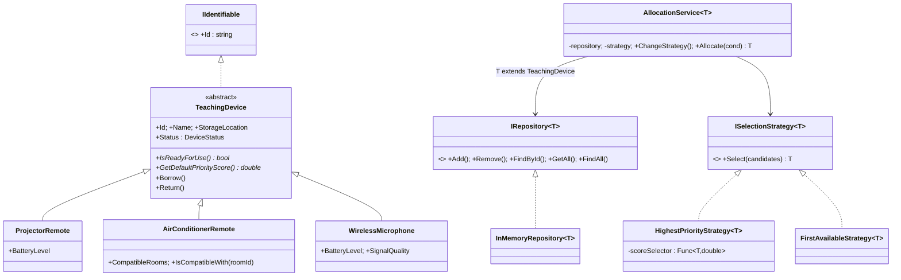

# Thiết kế hệ thống quản lý thiết bị phòng dạy

## 1. Sơ đồ lớp (UML)

## 2. Lớp trừu tượng, lớp dẫn xuất, interface

- **Lớp trừu tượng:** `TeachingDevice` (Id, Name, StorageLocation, Status, `Borrow`, `Return`; hai phương thức abstract).
- **Lớp dẫn xuất:** `ProjectorRemote`, `AirConditionerRemote`, `WirelessMicrophone`.
- **Interface:** `IIdentifiable`, `IRepository<T>`, `ISelectionStrategy<T>`.

## 3. Các vị trí dùng đa hình

1. `IsReadyForUse()` và `GetDefaultPriorityScore()`: mỗi loại thiết bị ghi đè khác nhau. `AllocationService` chỉ gọi qua kiểu cơ sở `TeachingDevice`.
2. `ISelectionStrategy<T>.Select()`: `HighestPriorityStrategy` và `FirstAvailableStrategy` có thể hoán đổi lúc chạy bằng `ChangeStrategy()`.
3. `Borrow()` gọi `IsReadyForUse()` (template method): hành vi chung ở lớp cơ sở, điều kiện sẵn sàng do lớp con quyết định.

## 4. Generic và ý nghĩa tham số kiểu

| Lớp/interface | Tham số kiểu | Ý nghĩa |
|---|---|---|
| `IRepository<T>` / `InMemoryRepository<T>` | `T : IIdentifiable` | Kho lưu bất kỳ đối tượng nào có `Id`. |
| `ISelectionStrategy<T>` | `T` | Chọn một phần tử từ danh sách mọi kiểu. Không cần ràng buộc. |
| `HighestPriorityStrategy<T>` | `T` | Hàm tính điểm `Func<T,double>` được truyền từ ngoài. |
| `AllocationService<T>` | `T : TeachingDevice` | Cần gọi `IsReadyForUse()` và `Borrow()`, nên T phải là thiết bị. |

## 5. Quyết định thiết kế và trade-off

**Quyết định:** dùng interface chiến lược `ISelectionStrategy<T>` thay vì chuỗi `if/else` theo loại thiết bị.

- **Lợi:** thêm `InteractiveDisplayRemote` hoặc chiến lược mới (ví dụ `RoundRobinStrategy`) không phải sửa `AllocationService` (Open/Closed). Kiểm thử từng chiến lược độc lập.
- **Đánh đổi:** nhiều lớp/interface hơn, người đọc phải lần theo abstraction. Với 2-3 loại thiết bị cố định thì hơi nặng nề, nhưng yêu cầu mở rộng của đề làm cho chi phí này đáng giá.

## 6. Trả lời câu hỏi định hướng 

1. **Hành vi chung (lớp cơ sở):** lưu Id/Name/StorageLocation, quản lý `Status`, `Borrow()`, `Return()`, kiểm tra hợp lệ dữ liệu.
2. **Hành vi ghi đè:** `IsReadyForUse()` và `GetDefaultPriorityScore()`.
3. **Kho có cần biết thiết bị cụ thể không?** Không. Kho chỉ cần `Id`, nên nó chỉ phụ thuộc `IIdentifiable`.
4. **if/else hay chiến lược?** Dùng interface chiến lược, vì if/else buộc phải sửa lớp cũ mỗi khi thêm cách chọn.
5. **Constraint đảm bảo có mã:** `where T : IIdentifiable`.
6. **Có cần generic cho mọi lớp không?** Không. Generic chỉ đáng dùng khi cùng một thuật toán áp dụng cho nhiều kiểu (kho, chiến lược). `TeachingDevice` và các lớp con có hành vi riêng nên dùng kế thừa/đa hình. Generic hóa mọi thứ làm mã khó đọc mà không có lợi ích tái sử dụng.

## 7. Trả lời câu hỏi mục 4\

1. **Vì sao cần constraint?** Để `FindById`, `Add` đọc được `item.Id` mà không biết lớp cụ thể, và trình biên dịch đảm bảo chỉ kiểu có `Id` mới vào được kho.
2. **Nếu bỏ constraint:** `T` chỉ là `object`, không truy cập được `Id`. Phải dùng reflection, ép kiểu `dynamic`, hoặc truyền thêm hàm lấy khóa, dễ lỗi lúc chạy thay vì lúc biên dịch.
3. **List<T> hay Dictionary<string,T>?**
   - `List<T>`: giữ thứ tự thêm, đơn giản, nhưng `FindById` và kiểm tra trùng là O(n).
   - `Dictionary<string,T>`: `FindById` và kiểm tra trùng O(1), nhưng thứ tự không được đảm bảo chính thức và tốn thêm bộ nhớ.
   - Bài này dùng **Dictionary + List** (index cho tra cứu, list giữ thứ tự cho `FirstAvailableStrategy`), đổi lại `Remove` là O(n) và dữ liệu lưu hai nơi.
4. **Vì sao không tạo ba repository riêng:** mã gần như giống hệt nhau (vi phạm DRY), sửa lỗi phải sửa ba nơi, và thêm loại thiết bị mới lại phải sao chép thêm một lớp. `InMemoryRepository<T>` giải quyết bằng một lớp duy nhất.
